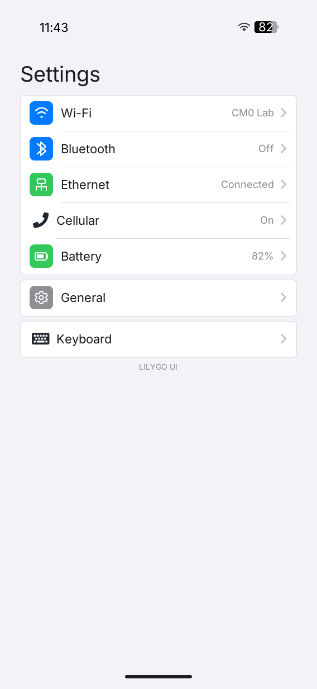
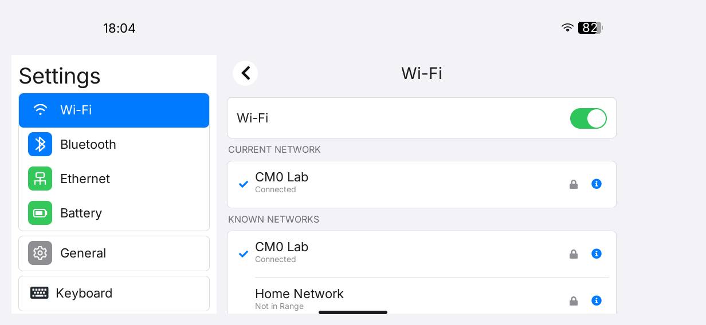
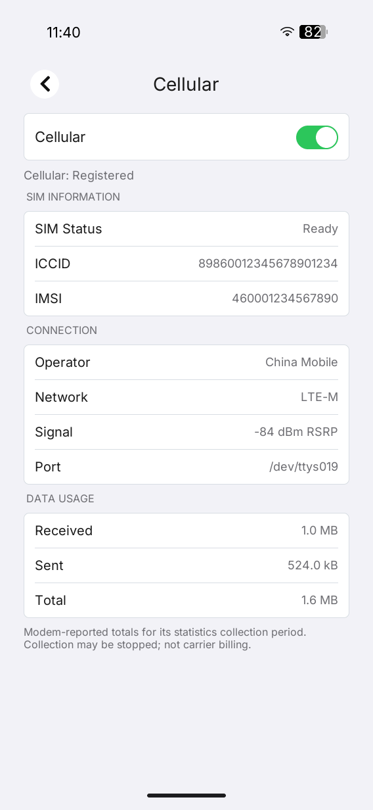
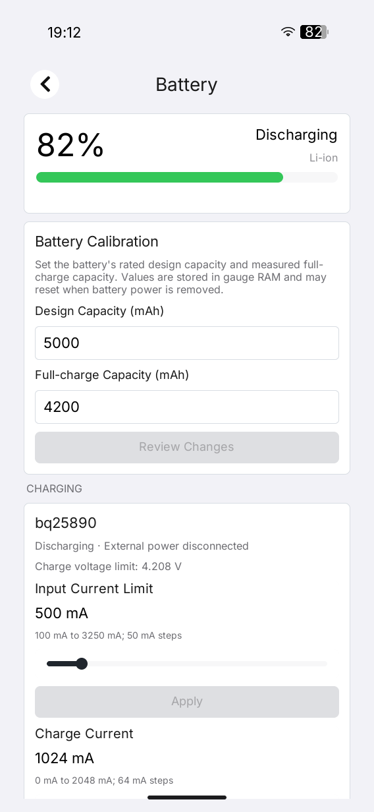

# LILYGO UI Settings

**English** | [简体中文](README.zh-CN.md)

LILYGO UI Settings is the system Settings application for LILYGO UI devices.
Built with C++17, [LILYGO UI AppKit](https://github.com/LILYGO-UI/cm0-appkit),
and LVGL 9.5, it configures networking, cellular radio and SIM status,
Bluetooth, battery and charging limits, keyboard vibration, SSH remote login,
serial console settings, and device information.

The project provides a CM0 ARM64 Linux build and an SDL2 desktop simulator. It
is a standalone top-level CMake project: the launcher is a runtime integration,
while the platform SDK is consumed through `find_package(LilyGoUI CONFIG REQUIRED)`.

## Preview

<p>
  
  
  
  
</p>

## Features

- **Responsive navigation:** landscape surfaces use a scrollable category sidebar
  and a details pane; portrait and square surfaces use single-page navigation.
  Layouts use the available container geometry and preserve the active page,
  focus, and input while the surface is resized.
- **Typography:** text uses AppKit's runtime font chain through
  `lilygo_ui_font_get()`, including Inter, Source Han Sans CN, and Font Awesome
  fallback glyphs; the application does not bundle LVGL Montserrat fonts.
- **Wi-Fi:** inspect the current connection, known NetworkManager profiles, and
  nearby networks; reconnect by profile UUID; view read-only TCP/IP, DNS, and
  hardware details; and forget a profile after confirmation.
- **Ethernet:** choose DHCP or manual IPv4 settings, edit DNS in either mode,
  validate values locally, and apply the selected NetworkManager connection.
- **Bluetooth:** control the radio, discover devices through BlueZ, and connect
  or disconnect devices while retaining MAC address identification.
- **Cellular:** control LTE on a Nordic nRF9151 Serial LTE Modem and inspect SIM,
  registration, operator, technology, signal, and optional data counters.
- **Battery and charging:** read BQ27220 fuel-gauge telemetry, calibrate design
  and full-charge capacities when supported, and adjust BQ25890 current limits.
- **General and sharing:** manage SSH Remote Login and the serial console, with
  explicit restart-now or restart-later handling for serial-console changes.
- **Keyboard and device information:** configure keyboard vibration, support
  physical-keyboard focus navigation, and show OS, device, memory, kernel, and
  filesystem information from About.

Optional hardware and services are reported as unavailable instead of preventing
the rest of Settings from opening. Administrator changes use the narrow policies
shipped in the complete Debian package; the application does not ask for or
store administrator passwords. Cellular access normally requires read/write
permission for `/dev/ttyACM0`.

## Development Environment

Run commands from the repository root. [`lpm.toml`](lpm.toml) is the
developer-maintained source for project metadata and build defaults, while
[`CMakePresets.json`](CMakePresets.json) defines the stable `host-simulator` and
`cm0-cross` configurations.

### Get the Source

```sh
git clone --recurse-submodules https://github.com/LILYGO-UI/settings.git
cd settings
```

For an existing checkout, initialize the pinned AppKit SDK:

```sh
git submodule update --init --recursive
```

The default presets use `third_party/cm0-appkit` as `LilyGoUI_DIR`. Applications
consume the SDK through its CMake package and do not enumerate AppKit or LVGL
private sources. A local SDK can be selected explicitly:

```sh
cmake --preset host-simulator -DLilyGoUI_DIR=/path/to/appkit
```

### Host Dependencies

The simulator needs CMake 3.21 or newer, CTest and CPack, a C/C++ compiler with
C++17 support, Git, `pkg-config`, SDL2 development files, and LPM 0.1.0 or
newer. `clang-format` is used by the optional pre-commit hook.

#### Debian 12 / Ubuntu 24.04 or Later

```sh
sudo apt update
sudo apt install build-essential cmake git pkg-config patch libsdl2-dev \
  libfreetype6-dev \
  python3 python3-venv python3-pip
```

#### macOS

Install the Xcode Command Line Tools if needed, then install host tools with
[Homebrew](https://brew.sh/):

```sh
xcode-select --install
brew install git cmake pkg-config patch sdl2 freetype python
```

#### LPM

CMake invokes `lpm metadata --format cmake` during configuration. If LPM is not
already installed, use a project-local Python environment:

```sh
python3 -m venv .venv
. .venv/bin/activate
python -m pip install "git+https://github.com/LILYGO-UI/lpm.git"
lpm --version
```

Reactivate the environment in each new shell. CMake searches `.venv/bin` and
`PATH`; an existing installation can also be selected with
`-DLPM_EXECUTABLE=/absolute/path/to/lpm`.

### Device Cross Compiler

CM0 builds need an AArch64 Linux cross compiler and the target libraries required
by the BSP and selected AppKit renderer. On Debian or Ubuntu:

```sh
sudo apt install gcc-aarch64-linux-gnu g++-aarch64-linux-gnu
```

On Apple Silicon macOS:

```sh
brew install aarch64-unknown-linux-gnu
```

The toolchain expects these names on `PATH`:

```sh
aarch64-linux-gnu-gcc --version
aarch64-linux-gnu-g++ --version
```

The cross preset downloads CM0 BSP 0.1.0 on first configuration, verifies its
SHA-256 checksum, and caches the sysroot under `.cache/cm0-bsp/0.1.0`. Change
the cache location with `-DCM0_BSP_CACHE_DIR=/absolute/path/to/cache`.

## Build and Test

### Desktop Simulator

Use LPM for the shortest development loop:

```sh
lpm start --foreground
```

After an initial build, reuse it with `lpm start --no-build --foreground`.
The simulator uses SDL2 and software rendering. Direct commands are:

```sh
cmake --preset host-simulator
cmake --build --preset host-simulator --parallel
./build/host-simulator/lilygo-ui-settings
```

### Tests

Run the complete host suite with:

```sh
lpm test
```

The suite covers backend parsing and mutation, platform command validation,
ViewModels, driver-protocol checks, sudoers syntax when `visudo` is available,
and no-display rendering scenarios.

| Test area | Coverage |
| --- | --- |
| Core and command runner | Settings state, parsing, validation, and command execution |
| Battery and cellular | Fuel-gauge behavior, calibration, serial protocol, and modem state |
| ViewModels | User commands, asynchronous updates, errors, and focus-safe refreshes |
| Page rendering | Home, Wi-Fi, Bluetooth, Ethernet, Cellular, Battery, General, About, Keyboard, and Sharing |
| Responsive scenarios | `320x568` compact, `568x1232` portrait, `1232x568` landscape, `1024x768` desktop, resize, reopen, serial, and physical-keyboard focus cases |

Render tests write PPM snapshots under `build/host-simulator`. Inspect affected
snapshots after UI changes; passing assertions alone does not verify text fitting,
focus visibility, or visual hierarchy.

### CM0 Device Build

Build and package the ARM64 device image with:

```sh
lpm pack
```

The equivalent CMake commands are:

```sh
cmake --preset cm0-cross
cmake --build --preset cm0-cross --parallel
cpack --config build/cm0-cross/CPackConfig.cmake -B dist
```

The Debian package is written as
`dist/lilygo-ui-settings_<version>_arm64.deb`. It installs the executable,
Launcher manifest and icon, desktop and AppStream metadata, BlueZ and power
helpers, Wi-Fi/Ethernet/SSH/serial/power sudoers policies, and AppKit font
license notices. The stable package and executable name is
`lilygo-ui-settings`; the application ID is `cc.lilygo.ui.Settings`.

The main files are installed at `/usr/bin/lilygo-ui-settings`,
`/usr/share/launcher/apps/cc.lilygo.ui.Settings.json`,
`/usr/share/icons/hicolor/128x128/apps/cc.lilygo.ui.Settings.png`, and
`/usr/libexec/lilygo-ui-settings-{bluetooth,power}`. Sudoers policies are
installed under `/etc/sudoers.d/`.

The package depends on `lilygo-ui-appkit-dev >= 0.1.0` and the target's DRM,
FreeType, BlueZ, systemd, and other declared runtime libraries. AppKit and LVGL
remain statically linked into the application; the AppKit package supplies the
source SDK, shared fonts, and licenses rather than shared AppKit or LVGL libraries.

The Debian metadata keeps `lilygo-cm0-settings` in `Provides`, `Conflicts`, and
`Replaces` only as a migration from the previously published package. Do not
reuse that legacy identity for new interfaces.

### GPU Renderer Builds

GPU rendering is selected by the source AppKit SDK at application build time.
Use an SDK that supports `LILYGO_UI_RENDERER` and a target sysroot containing
matching GBM/EGL/GLES development files. The pinned AppKit submodule and the
original BSP 0.1.0 are intended for software rendering; keep GPU builds in a
separate directory and use software rendering for simulator tests.

```sh
cmake --preset cm0-cross -B build/cm0-opengles \
  -DLilyGoUI_DIR=/path/to/appkit \
  -DCMAKE_TOOLCHAIN_FILE=/path/to/cm0-sysroot/usr/share/cm0-bsp/toolchain.cmake \
  -DLILYGO_UI_RENDERER=opengles
cmake --build build/cm0-opengles --parallel
cpack --config build/cm0-opengles/CPackConfig.cmake -B dist/opengles
```

### Underlying CMake Commands

<details>
<summary>Show direct configure, build, test, and package commands</summary>

```sh
# Host simulator
cmake --preset host-simulator
cmake --build --preset host-simulator --parallel
ctest --preset host-simulator

# CM0 device package
cmake --preset cm0-cross
cmake --build --preset cm0-cross --parallel
cpack --config build/cm0-cross/CPackConfig.cmake -B dist
```

</details>

### Troubleshooting

| Symptom | Action |
| --- | --- |
| `lpm` is unavailable during configuration | Activate `.venv`, put LPM on `PATH`, or set `LPM_EXECUTABLE`. |
| `LilyGoUI` or bundled LVGL cannot be found | Initialize `third_party/cm0-appkit` with `git submodule update --init --recursive`. |
| SDL2 is missing | Install the host SDL2 development package and rerun the host preset. |
| BSP download fails | Check access to the CM0 BSP release, disk space, and the configured cache directory. |
| Cross build cannot find target libraries | Install required libraries in the AArch64 sysroot; host libraries cannot substitute for them. |
| A privileged change is rejected | Install the complete Debian package so its narrow sudoers policies and helpers are present; platforms using `no_new_privs` need an equivalent privileged broker. |
| Cellular is unavailable | Grant read/write access to `/dev/ttyACM0`, close other modem sessions, and check `/tmp/lilygo_nrf9151_uart.lock`. |

## Platform Integration

The application keeps platform access behind small domain and command-runner
boundaries so optional hardware can fail independently:

- NetworkManager and `/sys/class/net` provide Wi-Fi and Ethernet state. Writes
  use fixed, package-installed `sudo -n` policies; passwords are never stored or
  passed in process arguments.
- rfkill, `bluetoothctl`, and the packaged BlueZ D-Bus helper provide Bluetooth
  radio and device state.
- The cellular page talks directly to the nRF9151 SLM over 115200 8N1 serial and
  does not use NetworkManager, ModemManager, or sudo.
- `/sys/class/power_supply` exposes BQ27220 and BQ25890 telemetry. Capacity
  calibration requires the board driver support described in
  [`data/kernel/README.md`](data/kernel/README.md).
- Sharing controls use systemd and `raspi-config`; restart is requested only
  after the user selects **Restart Now**.

See the [architecture overview](docs/00-overview.md) for the complete command
allow-list, sysfs and serial paths, environment overrides, driver requirements,
and authorization behavior.

Physical keyboards use AppKit's focus chain: `Tab` and `Shift+Tab` move between
controls, `Enter` activates the focused control, and `Esc` cancels text entry or
leaves the application. The software keyboard is suppressed while a physical
keyboard is available.

## Project Metadata

[`lpm.toml`](lpm.toml) is the single developer-maintained source for identity,
version, descriptions, license, permissions, compatibility, assets, build
presets, package output, and deployment defaults. CMake reads it through LPM and
generates the application identity header, Launcher manifest, desktop entry,
AppStream metadata, and Debian fields.

The stable public identity is:

```text
Package and executable  lilygo-ui-settings
Application ID          cc.lilygo.ui.Settings
```

Validate metadata with:

```sh
lpm metadata --format cmake
```

`publish.json` is temporary LPM output. Do not edit or commit it; update project
metadata only in `lpm.toml`.

## Documentation

| Guide | Contents |
| --- | --- |
| [Architecture overview](docs/00-overview.md) | Product boundaries, platform integration, data flow, permissions, and runtime behavior |
| [UI development guidelines](docs/01-user-interface.md) | Responsive layout, typography, ownership, and visual acceptance requirements |
| [Battery driver notes](data/kernel/README.md) | BQ27220 patch, calibration ABI, and learning-cycle guidance |
| [Asset notes](assets/images/README.md) | Source images and generated application artwork |

## Acknowledgments

The application uses LILYGO UI AppKit and LVGL for its runtime and UI system,
SDL2 for the desktop simulator, and FreeType-backed AppKit fonts. Device
integration follows the public interfaces of NetworkManager, BlueZ, systemd,
`raspi-config`, Linux power-supply and rfkill, and Nordic nRF9151 Serial LTE
Modem AT commands. Follow the relevant platform and hardware documentation when
deploying or redistributing the application.
