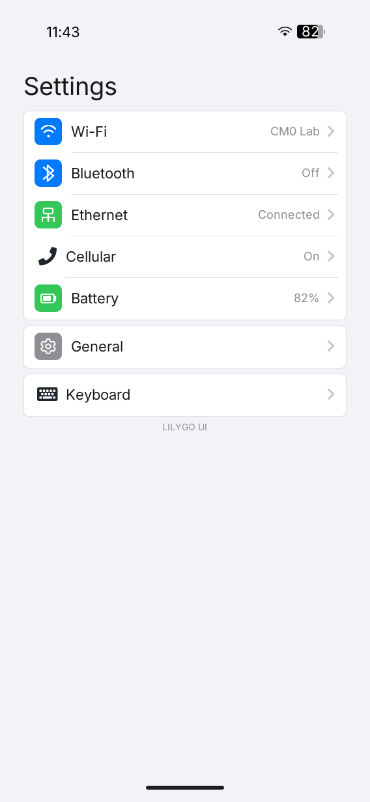
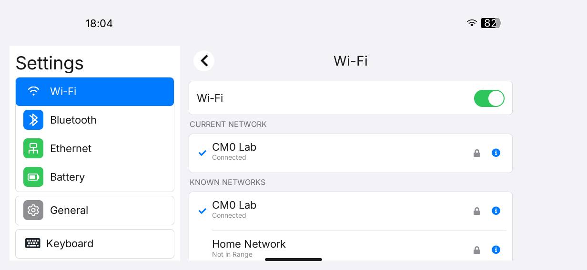
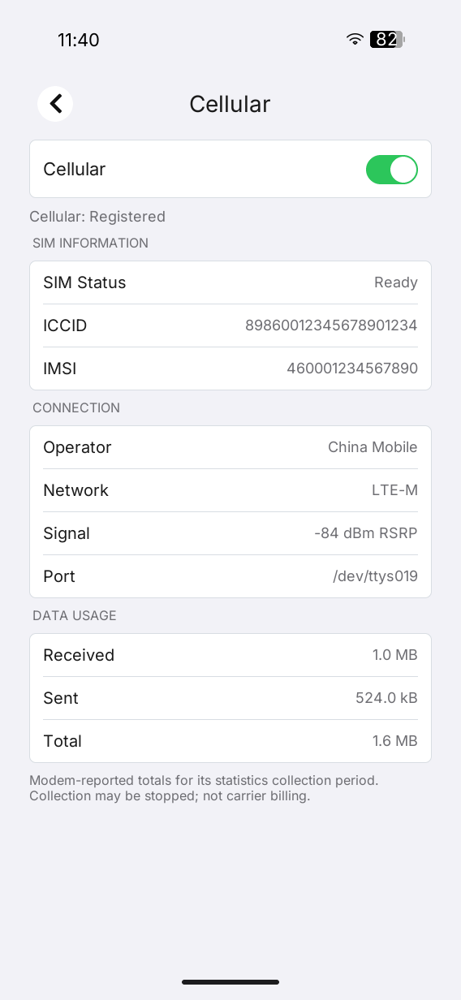
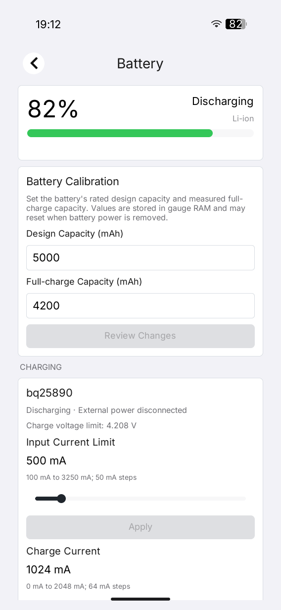

# LILYGO UI Settings

[English](README.md) | **简体中文**

LILYGO UI Settings 是面向 LILYGO UI 设备的系统设置应用。项目基于 C++17、
[LILYGO UI AppKit](https://github.com/LILYGO-UI/cm0-appkit) 和 LVGL 9.5
构建，用于配置网络、蜂窝网络与 SIM 状态、蓝牙、电池和充电限制、键盘振动、
SSH 远程登录、串口控制台以及设备信息。

项目提供 CM0 ARM64 Linux 设备构建和 SDL2 桌面模拟器，是可以独立配置、构建、
测试和打包的顶层 CMake 工程。Launcher 只负责运行时集成，平台 SDK 通过
`find_package(LilyGoUI CONFIG REQUIRED)` 使用。

## 预览

<p>
  
  
  
  
</p>

## 功能

- **响应式导航：** 横屏表面使用可滚动的分类栏和详情区域；竖屏和正方形表面
  使用单页导航。布局根据容器实际尺寸构建，调整尺寸时保留当前页面、焦点和输入。
- **字体：** 文本通过 `lilygo_ui_font_get()` 使用 AppKit 的运行时字体链，包含
  Inter、Source Han Sans CN 和 Font Awesome 回退字形；应用不打包 LVGL Montserrat 字体。
- **Wi-Fi：** 查看当前连接、NetworkManager 已知配置和附近网络；按配置 UUID
  重连；查看只读 TCP/IP、DNS 和硬件信息；确认后忽略网络配置。
- **Ethernet：** 在页面内选择 DHCP 或手动 IPv4 配置，两种模式都可以编辑 DNS，
  本地校验输入并应用选中的 NetworkManager 连接。
- **Bluetooth：** 控制蓝牙开关，通过 BlueZ 发现设备，并连接或断开设备；当设备
  没有提供友好名称时仍使用 MAC 地址标识。
- **Cellular：** 控制 Nordic nRF9151 Serial LTE Modem 的 LTE，查看 SIM、注册、
  运营商、制式、信号和可选的模组流量统计。
- **电池和充电：** 读取 BQ27220 电量计数据；在板级驱动支持时校准设计容量和满充
  容量；调整 BQ25890 输入电流和充电电流限制。
- **General 和 Sharing：** 管理 SSH Remote Login 和串口控制台，并对串口控制台
  变更提供明确的立即重启或稍后重启处理。
- **键盘和设备信息：** 配置键盘振动，支持实体键盘焦点导航，并在 About 页面显示
  操作系统、设备、内存、内核和文件系统信息。

可选硬件或服务不可用时，应用会显示不可用状态，而不会阻止其他设置页面打开。需要
管理员权限的修改使用完整 Debian 软件包附带的有限授权规则；应用不会请求或保存管理员
密码。蜂窝网络访问需要运行用户拥有调制解调器设备的读写权限，通常是 `/dev/ttyACM0`。

## 开发环境

请从仓库根目录运行项目命令。[`lpm.toml`](lpm.toml) 是开发者维护的项目元数据和
构建默认值来源，[`CMakePresets.json`](CMakePresets.json) 定义稳定的
`host-simulator` 和 `cm0-cross` 配置。

### 获取源码

```sh
git clone --recurse-submodules https://github.com/LILYGO-UI/settings.git
cd settings
```

已有检出目录需要先初始化锁定版本的 AppKit SDK：

```sh
git submodule update --init --recursive
```

默认 preset 将 `third_party/cm0-appkit` 作为 `LilyGoUI_DIR`。应用必须通过 SDK 的
CMake package 使用它，不枚举 AppKit 或 LVGL 的私有源文件。也可以显式选择本地 SDK：

```sh
cmake --preset host-simulator -DLilyGoUI_DIR=/path/to/appkit
```

### 主机依赖

桌面模拟器需要 CMake 3.21 或更新版本、CTest 和 CPack、支持 C++17 的 C/C++ 编译器、
Git、`pkg-config`、SDL2 开发文件以及 LPM 0.1.0 或更新版本。可选的提交前 hook 使用
`clang-format`。

#### Debian 12 / Ubuntu 24.04 或更新版本

```sh
sudo apt update
sudo apt install build-essential cmake git pkg-config patch libsdl2-dev \
  libfreetype6-dev \
  python3 python3-venv python3-pip
```

#### macOS

如有需要，先安装 Xcode Command Line Tools，再通过
[Homebrew](https://brew.sh/) 安装主机工具：

```sh
xcode-select --install
brew install git cmake pkg-config patch sdl2 freetype python
```

#### LPM

CMake 配置阶段会调用 `lpm metadata --format cmake`。如果尚未安装 LPM，可以创建
项目本地 Python 环境：

```sh
python3 -m venv .venv
. .venv/bin/activate
python -m pip install "git+https://github.com/LILYGO-UI/lpm.git"
lpm --version
```

每个新终端都需要重新激活环境。CMake 会搜索 `.venv/bin` 和 `PATH`；也可以在配置时
通过 `-DLPM_EXECUTABLE=/absolute/path/to/lpm` 选择已有安装。

### 设备交叉编译器

只构建桌面模拟器时可以跳过本节。CM0 构建需要 AArch64 Linux 交叉编译器，以及 BSP
和所选 AppKit 渲染器需要的目标库。

Debian 或 Ubuntu：

```sh
sudo apt install gcc-aarch64-linux-gnu g++-aarch64-linux-gnu
```

Apple Silicon macOS：

```sh
brew install aarch64-unknown-linux-gnu
```

工具链要求以下命令位于 `PATH`：

```sh
aarch64-linux-gnu-gcc --version
aarch64-linux-gnu-g++ --version
```

交叉 preset 第一次配置时会下载 CM0 BSP 0.1.0，校验 SHA-256，并将 sysroot 缓存到
`.cache/cm0-bsp/0.1.0`。可以通过
`-DCM0_BSP_CACHE_DIR=/absolute/path/to/cache` 修改缓存位置。

## 构建与测试

### 桌面模拟器

使用 LPM 可以获得最短的开发循环：

```sh
lpm start --foreground
```

首次构建后可以复用已有构建：

```sh
lpm start --no-build --foreground
```

模拟器使用 SDL2 和软件渲染。也可以直接执行相同的步骤：

```sh
cmake --preset host-simulator
cmake --build --preset host-simulator --parallel
./build/host-simulator/lilygo-ui-settings
```

### 测试

运行完整主机测试套件：

```sh
lpm test
```

测试覆盖后端解析和修改、平台命令校验、ViewModel、驱动协议检查、在系统存在
`visudo` 时的 sudoers 语法检查，以及无显示器渲染场景。

| 测试范围 | 覆盖内容 |
| --- | --- |
| Core 和 command runner | 设置状态、解析、校验和命令执行 |
| Battery 和 cellular | 电量计行为、校准、串口协议和模组状态 |
| ViewModel | 用户命令、异步更新、错误以及不影响焦点的刷新 |
| 页面渲染 | Home、Wi-Fi、Bluetooth、Ethernet、Cellular、Battery、General、About、Keyboard、Sharing |
| 响应式场景 | `320x568` 紧凑、`568x1232` 竖屏、`1232x568` 横屏、`1024x768` 桌面、尺寸变化、重新打开、串口和实体键盘焦点场景 |

渲染测试会在 `build/host-simulator` 下写入 PPM 快照。修改 UI 后请检查相关快照；
测试断言通过不能代替对文本适配、焦点可见性和视觉层次的检查。

### CM0 设备构建

使用以下命令构建并打包 ARM64 设备镜像：

```sh
lpm pack
```

对应的 CMake 命令为：

```sh
cmake --preset cm0-cross
cmake --build --preset cm0-cross --parallel
cpack --config build/cm0-cross/CPackConfig.cmake -B dist
```

Debian 软件包写入
`dist/lilygo-ui-settings_<version>_arm64.deb`。软件包安装可执行文件、Launcher
manifest 和图标、desktop 与 AppStream 元数据、BlueZ 和电源 helper、Wi-Fi/Ethernet/
SSH/serial/power sudoers 规则以及 AppKit 字体许可证。稳定的软件包和可执行文件名称为
`lilygo-ui-settings`，应用 ID 为 `cc.lilygo.ui.Settings`。

主要文件安装到 `/usr/bin/lilygo-ui-settings`、
`/usr/share/launcher/apps/cc.lilygo.ui.Settings.json`、
`/usr/share/icons/hicolor/128x128/apps/cc.lilygo.ui.Settings.png` 和
`/usr/libexec/lilygo-ui-settings-{bluetooth,power}`；sudoers 规则安装到
`/etc/sudoers.d/`。

软件包依赖 `lilygo-ui-appkit-dev >= 0.1.0`，以及目标系统提供的 DRM、FreeType、BlueZ、
systemd 和其他声明的运行库。AppKit 和 LVGL 静态链接到应用中；AppKit 软件包提供源 SDK、
共享字体和许可证，不提供 AppKit 或 LVGL 动态库。

Debian 元数据中的 `Provides`、`Conflicts` 和 `Replaces` 仅保留
`lilygo-cm0-settings`，用于从已发布的旧软件包迁移。新接口不得复用这个旧身份。

### GPU 渲染构建

GPU 渲染由源 AppKit SDK 在应用构建时选择。请使用支持 `LILYGO_UI_RENDERER` 的 SDK，
并准备包含匹配 GBM/EGL/GLES 开发文件的目标 sysroot。锁定的 AppKit submodule 和原始
BSP 0.1.0 面向软件渲染；GPU 构建应使用独立的构建目录，模拟器测试继续使用软件渲染。

```sh
cmake --preset cm0-cross -B build/cm0-opengles \
  -DLilyGoUI_DIR=/path/to/appkit \
  -DCMAKE_TOOLCHAIN_FILE=/path/to/cm0-sysroot/usr/share/cm0-bsp/toolchain.cmake \
  -DLILYGO_UI_RENDERER=opengles
cmake --build build/cm0-opengles --parallel
cpack --config build/cm0-opengles/CPackConfig.cmake -B dist/opengles
```

### 底层 CMake 命令

<details>
<summary>显示直接配置、构建、测试和打包命令</summary>

```sh
# 桌面模拟器
cmake --preset host-simulator
cmake --build --preset host-simulator --parallel
ctest --preset host-simulator

# CM0 设备软件包
cmake --preset cm0-cross
cmake --build --preset cm0-cross --parallel
cpack --config build/cm0-cross/CPackConfig.cmake -B dist
```

</details>

### 故障排查

| 现象 | 处理方式 |
| --- | --- |
| 配置阶段找不到 `lpm` | 激活 `.venv`，将 LPM 加入 `PATH`，或设置 `LPM_EXECUTABLE`。 |
| 找不到 `LilyGoUI` 或内置 LVGL | 使用 `git submodule update --init --recursive` 初始化 `third_party/cm0-appkit`。 |
| 缺少 SDL2 | 安装主机 SDL2 开发包后重新运行 host preset。 |
| BSP 下载失败 | 检查 CM0 BSP release 访问权限、磁盘空间和缓存目录。 |
| 交叉构建找不到目标库 | 将所需库安装到 AArch64 sysroot；主机库不能替代目标库。 |
| 设备拒绝需要权限的修改 | 安装完整 Debian 软件包以获得有限 sudoers 规则和 helper；使用 `no_new_privs` 的平台需要等效的特权 broker。 |
| 蜂窝网络不可用 | 为应用用户授予 `/dev/ttyACM0` 读写权限，关闭其他模组会话，并检查共享锁文件 `/tmp/lilygo_nrf9151_uart.lock`。 |

## 平台集成

应用将平台访问限制在小型 domain 和 command-runner 边界中，使可选硬件可以独立失效：

- Wi-Fi 和 Ethernet 使用 NetworkManager 与 `/sys/class/net` 获取状态。写操作使用软件包
  提供的固定 `sudo -n` 规则，密码不会保存，也不会出现在进程参数中。
- Bluetooth 使用 rfkill、`bluetoothctl` 和软件包提供的 BlueZ D-Bus helper 获取蓝牙状态。
- Cellular 通过 115200 8N1 串口直接访问 nRF9151 SLM，不使用 NetworkManager、ModemManager
  或 sudo。
- `/sys/class/power_supply` 提供 BQ27220 和 BQ25890 数据。容量校准需要板级驱动支持，
  详见 [`data/kernel/README.md`](data/kernel/README.md)。
- Sharing 使用 systemd 和 `raspi-config`，只有用户选择 **Restart Now** 后才会请求重启。

完整的命令白名单、sysfs 和串口路径、环境变量覆盖、驱动要求及授权行为见
[工程总览](docs/00-overview.md)。

实体键盘使用 AppKit 焦点链：`Tab` 和 `Shift+Tab` 在控件间移动，`Enter` 激活当前控件，
`Esc` 取消文本输入或退出应用。实体键盘可用时会抑制软件键盘。

## 项目元数据

[`lpm.toml`](lpm.toml) 是身份、版本、描述、许可证、权限、兼容性、资源、构建 preset、
软件包输出目录和部署默认值的唯一开发者维护来源。CMake 通过 LPM 读取它，并生成应用
身份头文件、Launcher manifest、desktop 文件、AppStream 元数据和 Debian 字段。

稳定的公开身份为：

```text
软件包和可执行文件  lilygo-ui-settings
应用 ID              cc.lilygo.ui.Settings
```

验证元数据：

```sh
lpm metadata --format cmake
```

`publish.json` 是 LPM 生成的临时输出，不要编辑或提交；项目元数据只应修改
`lpm.toml`。

## 文档

| 指南 | 内容 |
| --- | --- |
| [工程总览](docs/00-overview.md) | 产品边界、平台集成、数据流、权限和运行行为 |
| [UI 开发规范](docs/01-user-interface.md) | 响应式布局、字体、所有权和视觉验收要求 |
| [电池驱动说明](data/kernel/README.md) | BQ27220 补丁、校准 ABI 和学习周期说明 |
| [资源说明](assets/images/README.md) | 源图像和应用 artwork |

## 致谢

应用使用 LILYGO UI AppKit 和 LVGL 提供运行时及 UI 系统，使用 SDL2 运行桌面模拟器，
并使用基于 FreeType 的 AppKit 字体。设备集成遵循 NetworkManager、BlueZ、systemd、
`raspi-config`、Linux power-supply 与 rfkill，以及 Nordic nRF9151 Serial LTE Modem
AT 命令的公开接口。部署或再分发应用时，请遵循相关平台和硬件文档。
